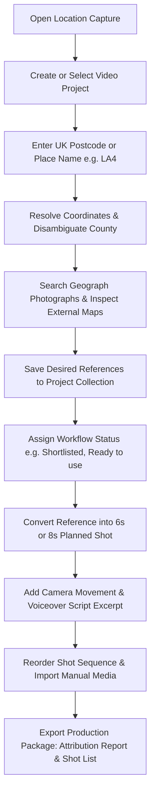

# Location Capture

> **A Location Research, Visual Discovery & Shot Planning Tool for *Britain Off Map***

**Location Capture** is a local-first desktop application designed specifically for the YouTube documentary channel *Britain Off Map*. It enables rapid research into real places across the United Kingdom, discovering geographically representative reference photographs, inspecting street-level architecture via Google Maps and Street View, structuring 6- and 8-second camera shot sequences aligned with voiceover scripts, and generating publish-ready Creative Commons attribution reports.

---

## 1. Key Capabilities

- **Location-First UK Resolution:**
  - Full UK Postcodes (e.g. `LA4 5AA`, `SR8 1DY`)
  - UK Outcode Districts (e.g. `LA4`, `HU19`, `SR8`)
  - UK Towns, Villages, and OS Settlements (e.g. `Morecambe`, `Easington`, `Easington, County Durham`)
  - Landmark & street queries via OpenStreetMap Nominatim fallback
  - Disambiguation picker for settlements sharing identical names across multiple UK counties

- **Geograph Britain and Ireland Official API Adapter:**
  - Real-time search of geographically representative UK photographs under Creative Commons licences (`CC BY-SA 2.0`)
  - Adjustable search radius (1km to 20km)
  - Automatic geodesic distance calculation (metres / kilometres) from the search centroid
  - Preserved metadata: original Geograph photo URL, photographer credit, photo ID, coordinates, and view direction
  - Strict compliance: no unauthorized web scraping, no image tile extraction, and no bulk harvesting
  - **Demo Mode**: Built-in curated dataset of real UK locations (Morecambe, Easington, Withernsea) for evaluation without an API key

- **Location Inspection & Rights-Aware Planning:**
  - **Google Maps & Street View:** Deep links directly to the resolved coordinates for external browser inspection of building facades, terraced streets, and topography without scraping or caching proprietary tiles.
  - **Google Earth Studio:** External link for pre-production camera trajectory planning, accompanied by explicit warnings regarding Google Earth Studio's commercial licensing policy for monetized YouTube channels.

- **Production Shot Planning Module:**
  - Target shot durations: **6-second** and **8-second** cuts tailored to *Britain Off Map*'s deliberate editorial pacing
  - Shot framing presets (Wide establishing, Street-level, Row of terraced houses, Approach, Coastal overview, Detail shot, etc.)
  - Camera movements (Static framing, Slow push-in, Slow pull-back, Gentle pan, Reveal, Transition)
  - Voiceover script excerpt linkage
  - Reorderable shot sequence with accessible controls and live total runtime calculation

- **Local Media Vault:**
  - Safe import workflow for manually downloaded assets and field footage
  - Strict MIME validation (JPEG, PNG, WebP, MP4, MOV, WebM), 50MB file size caps, and directory traversal sanitization
  - Attribution and licence snapshot preservation

- **Production Exports:**
  - **Attribution & Licence Report (`attribution-report.md`):** Formatted credits ready for YouTube video descriptions and copyright audit compliance.
  - **Ordered Shot List (`shot-list.md`):** Chronological shooting/editing guide with camera directions and script context.
  - **References Spreadsheet (`references.csv`):** Tabular export for production logs.
  - **Project Manifest (`project.json`):** Complete machine-readable archive.

---

## 2. Visual Direction & Design Palette

Built with a professional, desktop-first editorial aesthetic:
- **Deep Navy:** `#1B2A41` (primary chrome, headers, dark surfaces)
- **Soft Coral-Peach:** `#FD9E76` (interactive accents, primary action buttons)
- **Warm Cream:** `#F5F0E6` (content cards, light surfaces, backdrops)
- **Charcoal:** `#2B2B2B` (typography, high-contrast labels)

---

## 3. Technology Stack

- **Framework:** Next.js (App Router, React 19, TypeScript)
- **Styling:** Tailwind CSS v4 with bespoke editorial tokens
- **Database:** Local SQLite (`node:sqlite` DatabaseSync) with WAL mode, foreign keys, and automatic schema migrations
- **Validation:** Zod schemas
- **Icons:** Lucide React
- **Testing:** Node.js native test runner via `tsx --test`

---

## 4. Setup & Quick Start

### Prerequisites
- Node.js v20+ (Node v26 recommended)
- npm v10+

### Installation
```bash
# Navigate to the project directory
cd location-capture

# Install dependencies
npm install
```

### Environment Configuration
1. Request a free API key from Geograph:
   [https://www.geograph.org.uk/get-api-key.php](https://www.geograph.org.uk/get-api-key.php)
2. Copy `.env.example` to `.env.local`:
   ```bash
   cp .env.example .env.local
   ```
3. Open `.env.local` and add your key:
   ```env
   GEOGRAPH_API_KEY=your_geograph_api_key_here
   ```
*(Note: If you do not have an API key yet, the application operates in **Demo Mode** by default, allowing you to test all workflows using real UK photographic references).*

### Running Locally
```bash
# Start the development server
npm run dev

# Open in browser:
http://localhost:3000
```

### Running Automated Tests
```bash
npm test
```
The test suite covers:
1. Postcode and input normalization (full postcodes, outcodes, placenames)
2. Geographic distance calculations (Haversine formula) and CC BY-SA 2.0 attribution formatting
3. Provider registry and capability enforcement
4. Google Maps and Google Earth Studio inspection link generation
5. Media storage path safety and directory traversal prevention
6. SQLite persistence and duplicate reference prevention
7. Shot plan sequence reordering and duration tracking
8. Export generation (JSON, CSV, Markdown Attribution, Markdown Shot List)

### Production Build
```bash
npm run build
npm start
```

---

## 5. Core User Workflow



1. **Select or Create a Project:** Name your project (e.g. *Morecambe Bay & Coastal Housing*) and paste your working voiceover script section.
2. **Search Location:** Type an outcode (`LA4`, `HU19`), full postcode (`SR8 1DY`), town (`Morecambe`), or village (`Easington, County Durham`).
3. **Confirm Location:** View resolved coordinates, precision level, and county. If multiple settlements match, click the desired candidate from the disambiguation panel.
4. **Discover Visuals:** Browse real Geograph photographs with photographer credits, distance indicators, and CC BY-SA 2.0 badges.
5. **Inspect Street Level:** Click **Google Maps** or **Street View** to inspect street facades in an external browser tab.
6. **Save to Project:** Click **Add to Project** on relevant photographs. The database prevents accidental duplicates.
7. **Plan Shots:** Switch to the **Shot Planner** tab. Create timed 6- or 8-second shots with specified camera moves (e.g. *Slow push-in*, *Left-to-right reveal*), linking them directly to saved reference images and script sentences.
8. **Export:** Click the **Export** button in the header to download the **Attribution Report** (`attribution-report.md`) for YouTube description credits and the **Shot List** (`shot-list.md`) for your video editor.

---

## 6. Creative Commons & Rights Management

All photographs sourced from Geograph Britain and Ireland are licensed under **Creative Commons Attribution-ShareAlike 2.0 Generic (CC BY-SA 2.0)**:
- **Photographer Attribution:** Must be displayed alongside any use of the image.
- **Licence Link:** Must link back to the CC BY-SA 2.0 licence terms.
- **Source Link:** Must link back to the original Geograph photo page (`https://www.geograph.org.uk/photo/[id]`).
- **ShareAlike Clause:** If you adapt the image (e.g. cropping, color grading, or animating a Ken Burns digital zoom), the derivative portion must also be licensed under CC BY-SA 2.0.

### Google Earth Studio Notice
Google's official FAQ states that Google does not offer a licence for commercial applications using Google Earth imagery. Monetized YouTube videos require separate verified authorization or licensed stock footage alternatives. Location Capture treats Earth Studio solely as a pre-production camera route planning reference.

---

## 7. Project File Structure

```text
location-capture/
├── data/
│   └── location_capture.db       # Local SQLite database (WAL mode)
├── public/
│   └── imported-media/           # Application-managed media vault
├── scripts/
│   └── smoke-test.mjs            # End-to-end integration smoke test
├── src/
│   ├── app/
│   │   ├── api/
│   │   │   ├── locations/        # Location resolution & media search
│   │   │   ├── projects/         # Project CRUD, references, shots, media, export
│   │   │   └── system/config/    # System health & API key detection
│   │   ├── globals.css           # Deep navy, soft coral, warm cream tokens
│   │   ├── layout.tsx            # SEO metadata & responsive shell
│   │   └── page.tsx              # Primary desktop media research workspace
│   ├── components/               # Modular UI components (Header, Gallery, ShotPlanner, etc.)
│   ├── lib/
│   │   ├── database/             # SQLite database layer with node:sqlite
│   │   ├── exports/              # JSON, CSV, Attribution & Shot List generators
│   │   ├── location/             # UK postcode normalizer & postcodes.io resolver
│   │   ├── providers/            # Source adapter registry (Geograph, Maps, Earth, Stock)
│   │   ├── storage/              # Media manager & traversal protection
│   │   └── types.ts              # TypeScript domain types & interfaces
│   └── types/
│       └── sqlite.d.ts           # SQLite ambient module definitions
├── tests/
│   └── location-capture.test.ts  # Automated test suite
└── README.md
```

---

*Location Capture is built for Britain Off Map.*
